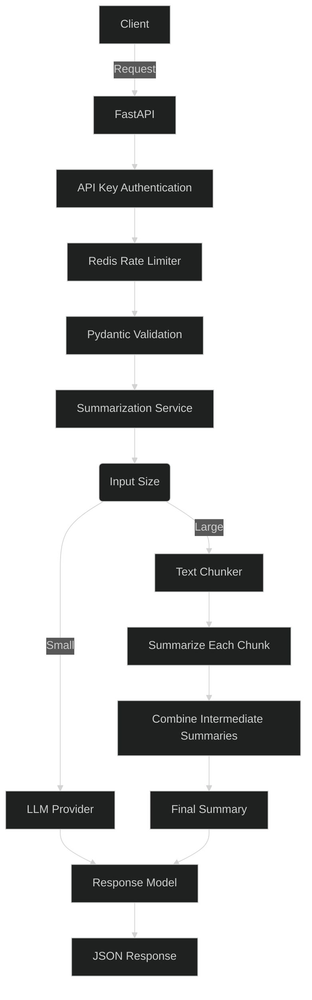
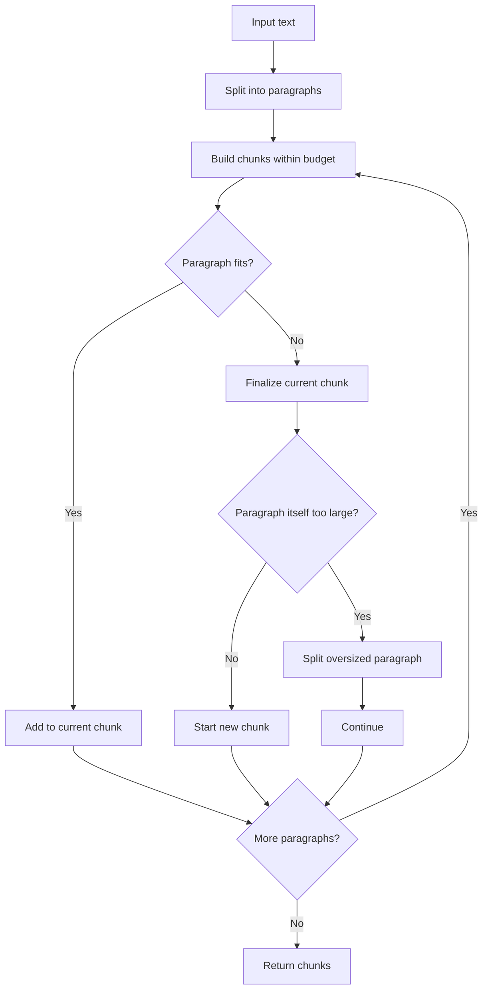
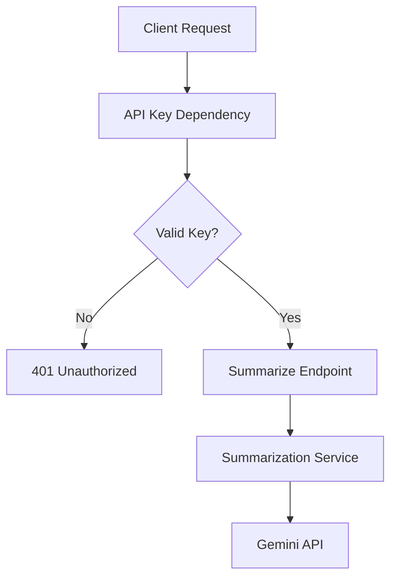

# AI Text Summarization API

A FastAPI-based REST API that accepts plain text and returns a structured summary powered by the **Google Gemini** large-language model.  
Large inputs are automatically split into paragraph-aware chunks, summarized independently, and then synthesized into a single final summary (map-reduce flow).

---

## Architecture



### Text Chunking Algorithm



### API Key Authentication Flow



---

## Project Structure

```
ai-text-summarization-api/
└── backend/
    ├── app/
    │   ├── core/
    │   │   └── config.py          # Pydantic Settings (env-driven configuration)
    │   ├── dependencies/
    │   │   └── auth.py            # API key verification via X-API-KEY header
    │   ├── schemas/
    │   │   └── summarize.py       # SummarizeRequest / SummarizeResponse models
    │   ├── services/
    │   │   ├── chunking.py        # Paragraph-aware text chunker
    │   │   └── summarization.py   # Gemini API client & map-reduce orchestration
    │   └── main.py                # FastAPI app, routes, error mapping
    ├── tests/
    │   ├── test_auth.py
    │   ├── test_chunking.py
    │   ├── test_health.py
    │   ├── test_setting.py
    │   ├── test_summarization_service_and_route.py
    │   └── test_summarize.py
    ├── docs/
    │   ├── plan.md                # Feature branch plan
    │   └── llm-selection.md       # LLM provider decision record
    ├── .env.example
    └── pyproject.toml
```

---

## Endpoints

| Method | Path | Auth required | Description |
|--------|------|:---:|-------------|
| `GET` | `/` | No | Hello-world probe |
| `GET` | `/health` | No | Health check — returns `{"status": "ok"}` |
| `POST` | `/summarize` | **Yes** | Summarize the submitted text |

### `POST /summarize`

**Request headers**

| Header | Value |
|--------|-------|
| `X-API-KEY` | Your API key (see [Configuration](#configuration)) |
| `Content-Type` | `application/json` |

**Request body**

```json
{
  "text": "The text you want summarized...",
  "length": "medium",
  "style": "paragraph"
}
```

| Field | Type | Required | Values |
|-------|------|:--------:|--------|
| `text` | `string` | ✓ | Non-empty; whitespace-only is rejected (`422`) |
| `length` | `string` | — | `short` · `medium` *(default)* · `long` |
| `style` | `string` | — | `paragraph` *(default)* · `bullet_points` · `executive` |

**Response body** (`200 OK`)

```json
{
  "summary": "..."
}
```

**Error codes**

| Code | Meaning |
|------|---------|
| `401` | Missing `X-API-KEY` header |
| `403` | Invalid API key |
| `422` | Request body validation failure |
| `429` | Gemini rate limit exceeded |
| `502` | Upstream provider error or malformed response |
| `504` | Gemini request timed out |

---

## Configuration

Copy `.env.example` to `.env` inside the `backend/` directory and fill in your values:

```env
GEMINI_API_KEY=your-google-ai-studio-api-key
GEMINI_MODEL=gemini-3.5-flash-lite
GEMINI_API_BASE_URL=https://generativelanguage.googleapis.com/v1beta
LLM_TIMEOUT_SECONDS=30.0
API_KEY=replace_with_your_token
```

| Variable | Description |
|----------|-------------|
| `GEMINI_API_KEY` | Google AI Studio API key (required) |
| `GEMINI_MODEL` | Gemini model ID |
| `GEMINI_API_BASE_URL` | Gemini REST base URL |
| `LLM_TIMEOUT_SECONDS` | Per-request timeout for Gemini calls (seconds) |
| `API_KEY` | Secret token clients must supply in `X-API-KEY` |

---

## Getting Started

### Prerequisites

- Python 3.13+
- [`uv`](https://github.com/astral-sh/uv) package manager

### Install & Run

```bash
cd backend
uv sync
cp .env.example .env   # then fill in your keys
uv run fastapi dev app/main.py
```

The API is now reachable at `http://localhost:8000`.  
Interactive docs: `http://localhost:8000/docs`

### Run Tests

```bash
cd backend
uv run pytest
```

---

## Development Phases

The project is delivered across six feature branches, each targeting a specific architecture component:

| # | Branch | Architecture Node | Key Deliverables |
|:-:|--------|-------------------|-----------------|
| 1 | `feat/pydantic-schemas` | Pydantic Validation & Response Model | `SummarizeRequest` / `SummarizeResponse`, input constraints, `422` tests |
| 2 | `feat/llm-provider` | LLM Provider | Base provider interface, `GEMINI_API_KEY` config via `.env`, mocked unit tests |
| 3 | `feat/summarization-service` | Summarization Service (small input) | Core `/summarize` endpoint, Gemini integration, provider error mapping |
| 4 | `feat/text-chunker` | Text Chunker & Map-Reduce Flow | Paragraph-aware splitting, per-chunk summarization, final synthesis |
| 5 | `feat/api-key-auth` ✅ | API Key Authentication | `X-API-KEY` header dependency, `401` / `403` tests |
| 6 | `feat/redis-rate-limiter` | Redis Rate Limiter | Redis setup, sliding/fixed-window limiter, `429` tests |

---

## Tech Stack

| Layer | Technology |
|-------|-----------|
| Framework | [FastAPI](https://fastapi.tiangolo.com/) |
| Validation | [Pydantic v2](https://docs.pydantic.dev/) |
| HTTP client | [HTTPX](https://www.python-httpx.org/) (async) |
| LLM provider | Google Gemini (`gemini-3.5-flash-lite`) |
| Config | `pydantic-settings` + `.env` |
| Testing | pytest + pytest-asyncio |
| Linting | Ruff |
| Package manager | uv |
